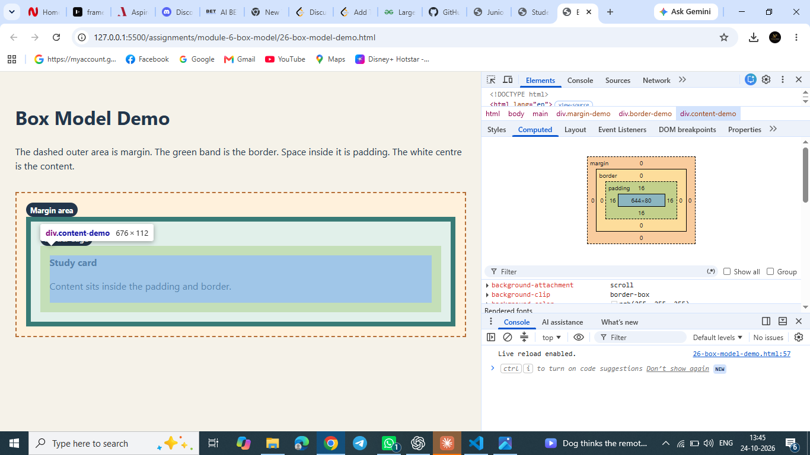

# Module 6: Box Model and Positioning

These practicals demonstrate how CSS spacing works and how positioned elements can be layered. The annotated screenshot is for Assignment 26.

## Practical checklist

- [x] **26 — Box model demo:** Identify margin, border, padding, and content in the demo and inspect the selected element in browser DevTools. See [screenshot notes](26-box-model-screenshot-notes.md).
- [x] **27 — Card variants:** Build three cards with distinct styles.
- [x] **28 — Overflow:** Show the overflowing layout, fix it, and record the change in [overflow notes](28-overflow-fix-notes.md).
- [x] **29 — Hero positioning:** Use positioning and `z-index` to layer the hero content.
- [x] **30 — Profile or product card:** Build a card layout with the box model in mind.

## Assignment 26 screenshot

The browser page labels the margin, border, padding, and content areas. DevTools shows the selected content element's box-model diagram.

